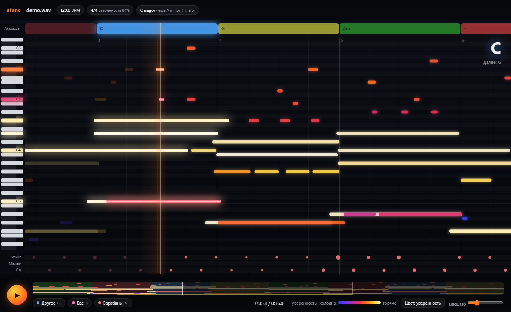
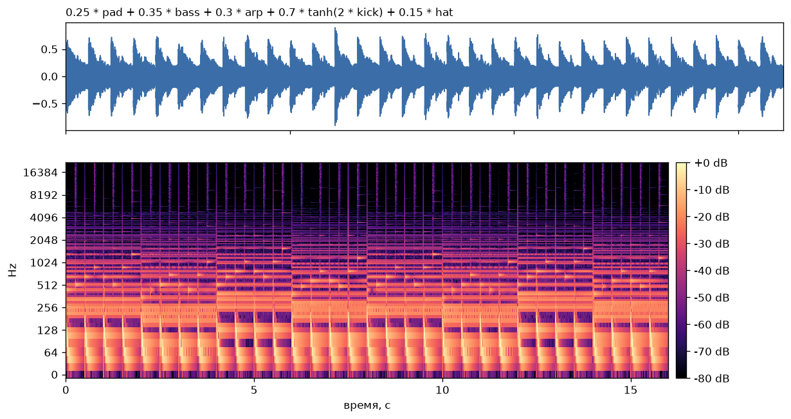
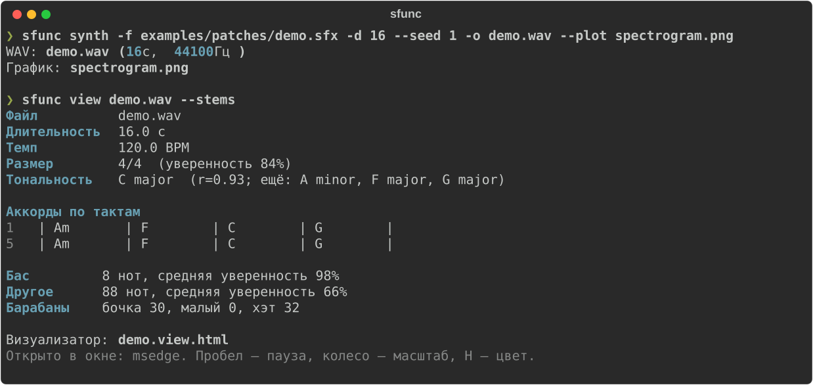
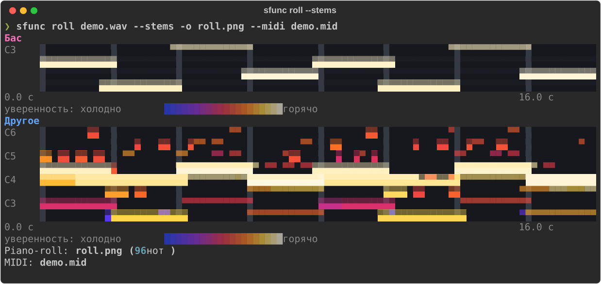
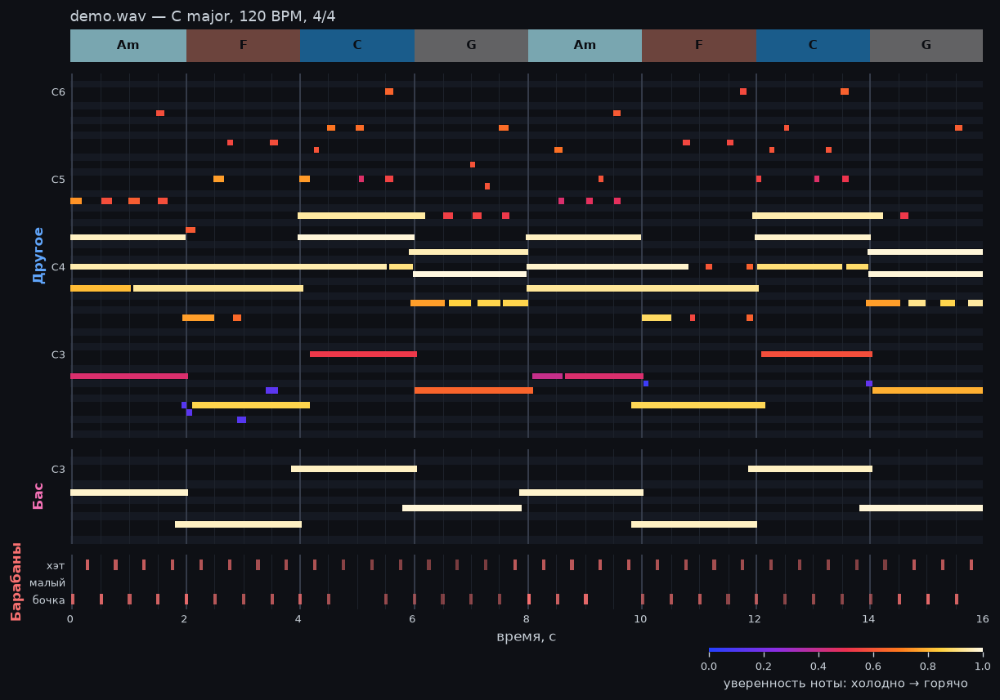

# sound_funk — `sfunc`

**Разбирает трек вместо вас и синтезирует звук из математических формул. Всё в одном CLI.**



Музыкантам приходится снимать песни на слух: искать темп, размер, тональность, аккорды и ноты каждого инструмента. `sfunc` делает это сам. Результат выводится в терминале и показывается в окне-визуализаторе: ноты светятся тем горячее, чем увереннее алгоритм, как на тепловизоре. Вторая половина проекта — синтез: пишете формулу и получаете звук.

Всё на этой странице сделано на одном 16-секундном треке, написанном формулой. В нём нет ни одного сэмпла.

> **Статус: ранний MVP.** Работают анализ, разделение на инструменты, визуализатор и синтез. Нейросетевая транскрипция нот и точный трекер сильных долей — следующие шаги, см. [ROADMAP.md](ROADMAP.md).

## Возможности

| Команда | Что делает |
|---|---|
| `sfunc view` | разбор в терминале и **окно-визуализатор** со звуком; `--stems` — по инструментам |
| `sfunc analyze` | темп (BPM), размер такта, тональность, аккорды по тактам; `--json`, `--stem bass` |
| `sfunc roll` | piano-roll в PNG и прямо в терминале, экспорт в MIDI; `--stems` — панель на каждый инструмент |
| `sfunc stems` | разделение на барабаны, бас, гитару, пианино, вокал и остальное (Demucs) |
| `sfunc synth` | звук из формулы: осцилляторы, FM, огибающие, фильтры, секвенсор; `--open` — сразу проиграть |
| `sfunc functions` | справочник функций для формул |

## Установка

Нужны Python 3.10+ и [uv](https://docs.astral.sh/uv/) (или pip). Для mp3 и m4a нужен ffmpeg в `PATH`.

```bash
git clone https://github.com/DoshiCkk/sound_funk.git
cd sound_funk
uv sync                    # анализ, визуализатор, синтез
uv sync --extra stems      # + разделение на инструменты (Demucs и PyTorch, несколько сотен МБ)
```

Модель Demucs (`htdemucs_6s`) скачивается при первом разделении. Готовые дорожки кешируются в `~/.cache/soundfunc`, поэтому второй раз тот же трек разбирается за секунды.

## Трек, написанный формулой

🎧 **Послушать:** [docs/demo.mp3](docs/demo.mp3) — 16 секунд, Am – F – C – G, 120 BPM. Или соберите его сами из [examples/patches/demo.sfx](examples/patches/demo.sfx):

```bash
uv run sfunc synth -f examples/patches/demo.sfx -d 16 --seed 1 -o demo.wav --open
```

### Из чего он собран

Трек — это одна формула, по слою на строку. Темп задаёт `beat = 0.5`, то есть доля длится полсекунды (120 BPM). Такт состоит из четырёх долей: `bar = 4 * beat`.

| Слой | Формула | Что звучит |
|---|---|---|
| Гармония | `root = seq(bar, 45, 41, 48, 43)` | корни аккордов A2 → F2 → C3 → G2, по такту на аккорд |
| | `third = seq(bar, 3, 4, 4, 4)` | терция: малая для Am, большая для F, C, G |
| Аккорды | `lowpass(saw(…) + saw(…) + saw(…), 1200)` | трезвучие из трёх пил октавой выше баса, приглушённое фильтром |
| Бас | `tanh(1.5 * sin(phase(midi(root)))) * exp(-4 * (t % beat))` | корень аккорда на каждую долю с мягким перегрузом |
| Арпеджио | `seq(step, 0, 1, 7, 12, 7, 1, 12, 19)` + `tri(…)` | восьмые: прима, терция, квинта, октава… треугольной волной |
| Бочка | `sin(phase(45 + 160 * exp(-35 * kt))) * exp(-9 * kt)` | синус, частота за доли секунды падает с 205 до 45 Гц |
| Хэт | `highpass(noise(), 7000) * exp(-60 * …)` | белый шум выше 7 кГц на слабые восьмые |
| Сведение | `0.25*pad + 0.35*bass + 0.3*arp + 0.7*tanh(2*kick) + 0.15*hat` | громкость каждого слоя |

<details>
<summary>Полный текст demo.sfx</summary>

```python
# Демо-трек: Am – F – C – G, 120 BPM — бочка, хэт, бас, аккорды и арпеджио
beat = 0.5
bar = 4 * beat
root = seq(bar, 45, 41, 48, 43)        # A2 F2 C3 G2 — по такту на аккорд
third = seq(bar, 3, 4, 4, 4)           # Am — малая терция, остальные мажорные

# аккорды: трезвучие октавой выше баса, пила через ФНЧ
chord = saw(phase(midi(root + 12))) + saw(phase(midi(root + 12 + third))) + saw(phase(midi(root + 19)))
pad = lowpass(chord, 1200) * (0.6 + 0.4 * exp(-3 * (t % bar)))

# бас: корень на каждую долю
bass = tanh(1.5 * sin(phase(midi(root)))) * exp(-4 * (t % beat))

# арпеджио восьмыми; 1 — метка «терция аккорда»
step = beat / 2
up = seq(step, 0, 1, 7, 12, 7, 1, 12, 19)
arp = tri(phase(midi(root + 24 + where(up == 1, third, up)))) * exp(-10 * (t % step))

# ударные: бочка на долю, хэт на слабые восьмые
kt = t % beat
kick = sin(phase(45 + 160 * exp(-35 * kt))) * exp(-9 * kt)
hat = highpass(noise(), 7000) * exp(-60 * ((t + beat / 2) % beat))

0.25 * pad + 0.35 * bass + 0.3 * arp + 0.7 * tanh(2 * kick) + 0.15 * hat
```

</details>

### Как он выглядит



Флаг `--plot` рисует осциллограмму и спектрограмму. На ней видно каждый слой формулы:

- **яркие «крючки» внизу каждые 0.5 с** — бочка: частота падает с 205 до 45 Гц;
- **тонкие вертикальные линии наверху между ними** — хэт, шум выше 7 кГц;
- **горизонтальные полосы, которые сдвигаются каждые 2 с** — гармоники аккордов, по такту на аккорд.

## Разбор трека: что заложено и что нашёл `sfunc`

Отдаём получившийся `demo.wav` анализатору, как будто это чужая песня. `view` печатает разбор в терминале и открывает окно-визуализатор:



| Параметр | Заложено в формуле | Нашёл анализатор |
|---|---|---|
| Темп | `beat = 0.5` → 120 BPM | **120.0 BPM** |
| Размер | 4 доли в такте, `bar = 4 * beat` | **4/4** (уверенность 84%) |
| Аккорды | Am → F → C → G, по такту, два круга | **`| Am | F | C | G |`** во всех 8 тактах |
| Тональность | все ноты из до мажора / ля минора | **C major**, вторым вариантом A minor |

С тональностью оба ответа честные. Am – F – C – G — это ступени vi – IV – I – V до мажора, и та же последовательность звучит как ля минор, если опираться на Am. Поэтому `sfunc` показывает C major и сразу предлагает A minor как ближайшую альтернативу.

### Откуда берутся проценты уверенности

- **Размер:** на каждой доле считается «акцент» (смена гармонии ×2, удар в низах ×1, общая громкость ×0.5). Затем сравнивается, насколько выделяется первая доля при группировке по 4 и по 3. В демо получилось 5.41 против 0.46, отсюда (5.41 − 0.46) / (5.41 + 0.46) = 84%.
- **Тональность (`r`):** корреляция профиля 12 нот трека с эталонными профилями 24 тональностей (Крумхансл и Кесслер, 1982). Важнее разрыв между первым и вторым местом: 0.93 против 0.80.
- **Нота:** насколько она близка к самому громкому звуку в своих кадрах и сколько длится. Короткие тихие всплески — частые ложные срабатывания, они получают холодный цвет.

Всё это эвристики без нейросетей. Проценты показывают, насколько ответ выделяется среди вариантов, но это не вероятность.

## Окно-визуализатор

```bash
uv run sfunc view demo.wav --stems
```

Окно открывается в Edge или Chrome без рамок браузера. Это самодостаточная HTML-страница, в которую встроены данные и звук, поэтому её можно переслать (`demo.view.html`). Что видно на скриншоте в начале страницы:

- ноты едут справа налево к светящейся линии воспроизведения. В момент удара нота вспыхивает и разлетается искрами, клавиша слева подсвечивается её цветом;
- **цвет ноты — уверенность распознавания:** синий и фиолетовый — сомнительно, красный и оранжевый — средне, жёлтый и белый — уверенно;
- сверху полоса аккордов, справа крупно текущий аккорд и следующий;
- снизу дорожки бочки, малого и хэта, удары вспыхивают на линии;
- внизу мини-карта всего трека для перемотки, кнопки включения инструментов и шкала уверенности.

Управление: **Пробел** — пауза, **←/→** — ±5 с, **колесо** — масштаб, **H** — цвет по уверенности или по инструменту, клик по мини-карте или по полю — перемотка, наведение на ноту — её название, время и уверенность.

## Ноты по инструментам

```bash
uv run sfunc roll demo.wav --stems -o roll.png --midi demo.mid
```

С `--stems` трек сначала делится нейросетью Demucs на дорожки, и ноты ищутся в каждой отдельно. Пустые дорожки (в демо нет вокала, гитары и пианино) пропускаются. Piano-roll рисуется сразу в терминале:



И в PNG, по панели на инструмент, плюс дорожка ударных:



MIDI получается с отдельной дорожкой на инструмент, барабаны идут на 10-м канале (General MIDI). Файл открывается в любой DAW: Ableton, FL Studio, Reaper, MuseScore.

Сравним с формулой, сколько транскрипция нашла по слоям:

| Слой | Без разделения (`sfunc roll`) | По инструментам (`--stems`) |
|---|---|---|
| Бас | ✅ 8 из 8 нот | ✅ 8 из 8, средняя уверенность 98% |
| Ноты аккордов | ⚠️ 8 из 24: только средняя нота, октаву и квинту съедали обертоны баса | ✅ **20 из 24** |
| Арпеджио | ⚠️ 21 из 64 | ⚠️ 26 из 64 |
| Бочка | ❌ ложная нота F#1 через весь трек (гул 45 Гц) | ✅ 30 из 32 ударов на своей дорожке |
| Хэт | не виден | ✅ 32 из 32, все между долями |
| Малый | — | ✅ 0 ложных (его в треке нет) |

Разделение сильнее всего помогло аккордам: бас ушёл на свою дорожку, и его обертоны больше не маскируют ноты аккорда. Тихое быстрое арпеджио пока теряется. Это работа для нейросетевой транскрипции из плана.

## Свои треки

```bash
sfunc view song.mp3 --stems                       # разбор + окно-визуализатор
sfunc analyze song.mp3 --start 30 --duration 20   # только фрагмент
sfunc analyze song.mp3 --stem bass                # разобрать одну дорожку
sfunc analyze song.mp3 --json > song.json         # для своих скриптов
sfunc stems song.mp3                              # дорожки в папку song_stems/
sfunc roll song.mp3 --stems --midi song.mid --open
```

## Свои звуки из формул

```bash
sfunc synth "sin(2*pi*440*t) * exp(-3*t)" -d 2 -o beep.wav --open
sfunc synth "sin(phase(220 + 30*sin(2*pi*5*t)))" -o vibrato.wav --plot vibrato.png
sfunc synth -f examples/patches/bell.sfx -p f=440 -d 4 -o bell.wav
sfunc functions                                   # справочник функций
```

Формула — это выражение от времени `t` в секундах. В файле `.sfx` можно задавать переменные и оставлять комментарии; результатом считается последняя строка.

| Группа | Функции |
|---|---|
| Математика | `sin cos tan tanh exp log sqrt abs sign floor min max clip where`, операторы `+ - * / ** % //`, сравнения `t < 1` (дают 0 или 1) |
| Осцилляторы | `saw(x)`, `square(x, duty)`, `tri(x)`, `noise()`; принимают фазу в радианах, как `sin` |
| Частота | `phase(f)` — интеграл частоты для правильных FM, вибрато и глиссандо; `note("A4")`, `midi(69)` |
| Время | `seq(step, v1, v2, ...)` — пошаговый секвенсор; `adsr(a, d, s, r)` — огибающая |
| Обработка | `lowpass(x, fc)`, `highpass(x, fc)`, `echo(x, delay, feedback)` |
| Переменные | `t`, `n` (номер сэмпла), `sr`, `T` (длительность), `pi`, `tau`, `e`, свои через `-p name=value` |

Готовые патчи в [examples/patches](examples/patches):

| Патч | Что внутри | Команда |
|---|---|---|
| [demo.sfx](examples/patches/demo.sfx) | трек с этой страницы | `-d 16 --seed 1` |
| [arp.sfx](examples/patches/arp.sfx) | арпеджио Am – C – G – F с бочкой | `-d 8` |
| [bell.sfx](examples/patches/bell.sfx) | FM-колокол | `-d 4 -p f=440` |
| [kick.sfx](examples/patches/kick.sfx) | бочка из синуса с падением высоты | `-d 0.6` |
| [pad.sfx](examples/patches/pad.sfx) | пэд из расстроенных пил | `-d 6` |

Формулы не передаются в `eval`. Разрешены только числа, арифметика, сравнения и функции из таблицы, поэтому чужой `.sfx` безопасно запускать. Если в формуле ошибка, команда объяснит её понятным сообщением, например `неизвестная функция 'sinn'`.

## Как это работает

| Задача | Метод |
|---|---|
| Темп и доли | `librosa.beat.beat_track` по сглаженной onset-огибающей мел-спектра; темп — регрессия по всем долям |
| Размер такта | акцент на каждой доле: смена гармонии (окно 2 доли), удар в низах, общий onset; выбирается группировка по 3 или по 4 |
| Тональность | Крумхансл–Шмуклер: корреляция хромы с профилями 24 тональностей |
| Аккорды | шаблоны мажорных и минорных трезвучий по хроме гармонической части (от C2, без суббаса), сглаживание Витерби, привязка к долям |
| Разделение | нейросеть Demucs `htdemucs_6s` (Meta): 6 дорожек, кеш по хешу файла |
| Ноты | CQT с разрешением 1/3 полутона, пики по высоте, подавление обертонов; уверенность — запас громкости в кадре и длительность |
| Ударные | всплеск энергии (spectral flux) отдельно в низах, середине и верхах; шумовой спектр отличает малый и хэт от гармоник перегруженной бочки |
| Визуализатор | HTML + Canvas, звук встроен в страницу; окно Edge/Chrome в режиме `--app` |

Нейросеть в проекте одна — Demucs, и только для разделения. LLM не используются.

## Ограничения

- **Транскрипция нот наивная**, без нейросети: на быстрых тихих партиях (арпеджио) теряется больше половины нот.
- **Уверенность — эвристика**, а не вероятность модели. Она станет настоящей, когда подключим basic-pitch.
- **У Demucs слабые дорожки пианино и гитары** (это признают и авторы модели): часть партий может уйти в «Другое».
- **Размер различается только как 3/4 или 4/4**, аккорды — только мажорные и минорные трезвучия, тональность одна на весь трек.

## Дальше

Кратко из [ROADMAP.md](ROADMAP.md):

1. **Транскрипция нот нейросетью** basic-pitch: больше найденных нот и настоящая вероятность вместо эвристики.
2. **Синтез 2.0:** live-coding, стерео, инструменты из формул по MIDI.
3. **Нейросетевые доли**, сложные размеры, септаккорды, структура песни.
4. **Гитарные табы**, MusicXML и экспорт видео из визуализатора.

## Разработка

```bash
uv sync --extra dev --extra stems
uv run pytest                          # тесты
uv run python scripts/make_docs.py     # пересобрать картинки, скриншоты и demo.mp3 для README
```

Тесты анализа проверяют темп, размер, тональность, аккорды, ноты и удары барабанов на синтетических треках с заранее известным ответом. Отдельный тест проходит полный круг: формула → звук → анализ.
